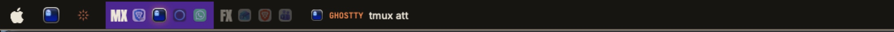
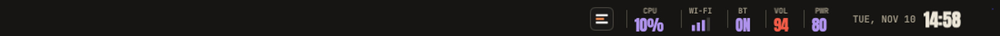

# Regionativo

A drafting-sheet bar for OmniWM: Anton headlines, mono annotations and flat orange and purple.

## Previews

## What it changes

Colours, type and shapes follow one design language, with light and dark palettes.
The bar reads like a drawing's title block: square cells with a mono label over an Anton value
(CPU, Wi-Fi as a row of book spines, Bluetooth, volume, battery), levels coloured from purple
(calm) through amber and orange to red (critical), and one strong rule along the bottom edge.
The active workspace is a solid purple block with softly rounded corners, the focused app
underlined by a short orange rule; the others step back to muted names with their app icons
kept large and bright, and empty ones are struck through in orange. Floating windows sit
behind a marker of two overlapping squares. Hovering a workspace lifts it, Dock-style, and the app icon
under the pointer zooms in. While the camera or microphone is in use, a CAM / MIC cell
lights up in red or orange. The clock is set in Anton with a mono date, and Control
Center is a dark tile with a menu mark. Popouts are square frames inset from the window edge, with Anton
headings over a rule.

## Controls and commands

Everything uses OmniWM's stock widgets: click a cell for its panel. The sound panel adds a
microphone card (mute and input level). Choose the style in **Settings > Styles & Widgets**;
the bar background is a static drawing (no ongoing GPU use) with its strength under **Bar**.

Widget authors: the style answers an optional `look.chip(ctx, {label, value, hue, symbol, quiet})`,
so your own widgets can render as title-block cells.

## Credits and licences

Style code is GPL-2.0-only (see [LICENSE](LICENSE)); it builds on OmniWM's Default skin by
OmniNull. Fonts are SIL Open Font License 1.1, notices in `fonts/`: Anton, Inter and
JetBrains Mono.
